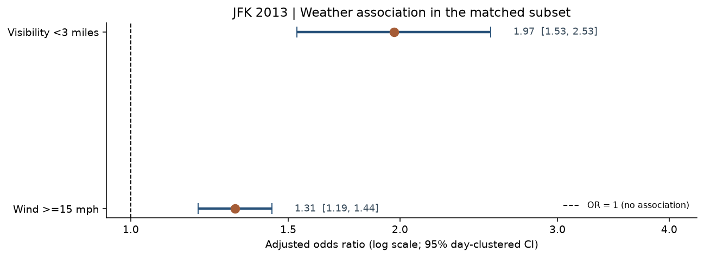
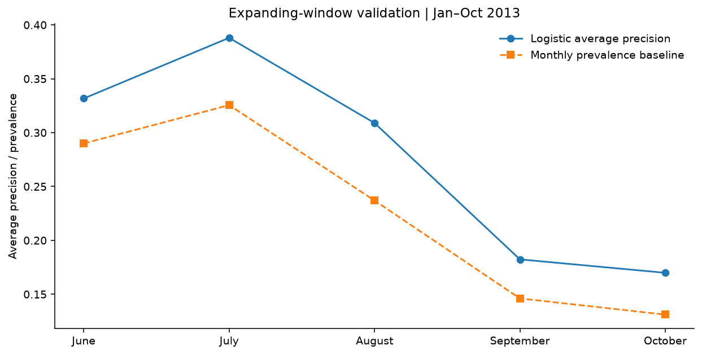
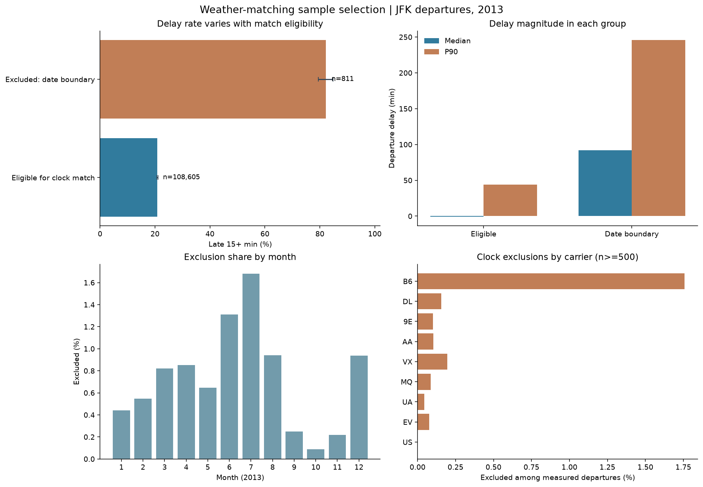
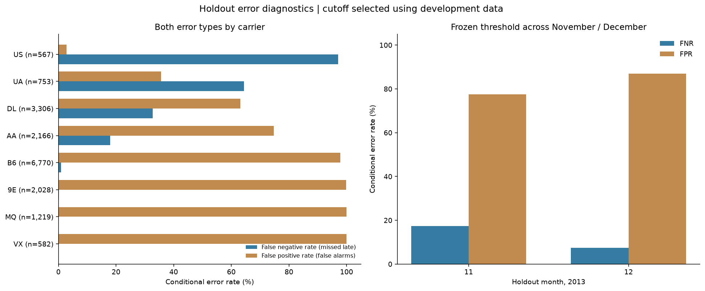

# ✈️ JFK Airport Flight Delay Analysis


This project analyzes **flight delays at John F. Kennedy International Airport (JFK)** using historical flight and weather data from 2013.

The analysis examines how departure delays vary across airlines, destinations, and time periods, and explores whether information available before departure can help identify flights with a higher risk of delay.

Beyond exploratory data analysis, the project includes statistical modeling, machine learning, weather-related comparisons, and model validation. It also examines how missing data, weather matching, and model limitations affect the reliability of the findings.

---

## 🔍 Project Overview

### Objective

- Analyze historical flight delay patterns at JFK Airport.
- Identify differences in delay rates across airlines, routes, and time periods.
- Explore associations between weather conditions and departure delays.
- Evaluate machine learning models for ranking departure delay risk.
- Assess data quality, model performance, and prediction uncertainty.

### Key Questions

1. Which airlines, routes, and time periods experienced higher departure delay rates?
2. Were extreme delays concentrated on particular days, and how did departure delays change by arrival?
3. How were recorded weather conditions associated with flight delays?
4. Can statistical and machine learning models identify flights with higher delay risk?
5. How reliable are these results across different periods and data-quality conditions?

### Dataset Overview

| Dataset | Description |
|---|---|
| `jfk_flights.csv` | 111,279 JFK departure records from 2013 |
| `jfk_weather2013_2.csv` | 13,424 historical JFK weather observations |
| Analysis period | January–December 2013 |
| Primary target | Departure delay of at least 15 minutes |
| Historical test period | November–December 2013 |

Of the 111,279 flight records, 109,416 contain a measured departure delay. Records without a measured delay are not automatically classified as canceled flights.

The project focuses on retrospective analysis rather than real-time flight prediction.

---

## 🧠 Methodology

### 1. Data Cleaning & Preparation

The flight and weather datasets were inspected and prepared for analysis.

- Examined missing values, data types, and inconsistent records.
- Standardized date and time fields.
- Created departure delay indicators and severity categories.
- Compared records with and without measured departure delays.
- Reviewed weather matching coverage and sample selection.
- Checked how data limitations could affect the analysis.

The flight dataset does not contain an independently recorded scheduled departure timestamp. Reconstructed departure times are used for descriptive analysis only, not as prospective prediction features.

### 2. Exploratory Data Analysis (EDA)

Exploratory analysis examines how departure delays differ across the historical flight records.

The analysis includes:

- Monthly and daily delay trends.
- Airline-level delay comparisons.
- Destination and route-level delay patterns.
- Delay distributions and extreme-delay events.
- Departure and arrival delay comparisons.
- Aircraft delay persistence across observed JFK departures.

### 3. Weather & Statistical Analysis

Historical weather observations were matched with flight records to examine possible relationships between weather conditions and delays.

The analysis includes:

- Visibility, wind speed, temperature, and precipitation comparisons.
- Weather observation matching and timestamp sensitivity checks.
- Missing weather measurements and sample attrition.
- Adjusted logistic regression models.
- Odds ratios and confidence intervals.
- Weather interaction analysis.

Weather-related findings are observational. Unverified timestamp conventions and incomplete weather measurements limit how broadly the results can be interpreted.

### 4. Machine Learning & Prediction

Two classification models were evaluated for predicting whether a flight would depart at least 15 minutes late.

- **Logistic Regression**
- **Gradient Boosting**

The modeling workflow includes:

- Chronological training, validation, and testing.
- ROC-AUC and Average Precision evaluation.
- Precision–Recall curve analysis.
- Probability calibration.
- Feature importance and feature ablation.
- High-risk flight ranking.
- Subgroup error analysis.

Additional experiments examine delays of 60 and 120 minutes, along with quantile regression for positive departure delays.

### 5. Model Validation & Robustness

Model evaluation extends beyond a single accuracy metric.

The notebook includes:

- Expanding-window validation.
- Bootstrap confidence intervals.
- Probability calibration and Brier Score comparisons.
- Airline-level calibration and error checks.
- Data drift analysis.
- Weather matching sensitivity tests.
- Illustrative operational cost scenarios.

The November–December 2013 test period was reviewed during project development. Results from that period are retrospective and should not be treated as a new, independent external validation.

---

## 📊 Key Insights

### 1. Departure Delay Patterns

Approximately **21.3%** of flights with a recorded departure delay were delayed by at least 15 minutes.

Delay rates varied across airlines, destinations, and time periods. Extreme delays were also concentrated on certain days rather than evenly distributed throughout the year.

These findings describe historical 2013 conditions rather than current JFK operations.

### 2. Weather Analysis Requires Careful Data Selection

Weather analysis involved additional data filtering and matching.

- **108,605 flights** remained eligible after estimated flight-clock checks.
- **88,340 flights** had the visibility and wind measurements required for the main adjusted weather regression.
- Flights excluded near ambiguous date boundaries had substantially higher observed delay rates.

As a result, the weather analysis describes a selected subset of flights rather than the entire JFK dataset.

### 3. Machine Learning Models Identified Some Delay Risk

The historical test results were:

| Metric | Result |
|---|---:|
| Logistic Regression ROC-AUC | 0.596 |
| Logistic Regression Average Precision | 0.252 |
| Gradient Boosting Average Precision | 0.231 |
| Test-period delay prevalence | 0.196 |
| Brier Score before calibration | 0.182 |
| Brier Score after Platt calibration | 0.157 |

Logistic Regression achieved higher Average Precision than Gradient Boosting during the historical test period.

Although the models showed some ability to identify higher-risk flights, their predictive performance remained limited.

### 4. Higher Predicted Risk Did Not Always Mean a Delay

The highest-scored 10% of test flights had an observed delay rate of approximately **27.0%**, compared with 19.6% across the full test period.

This represents about 1.38 times the overall test-period rate.

The result suggests some ability to rank historical delay risk, but it does not guarantee reliable predictions for future flights.

### 5. Model Reliability Matters

Probability calibration improved the historical Brier Score, but some airline groups still showed high false-alarm rates.

The results demonstrate why model performance should be evaluated using calibration, subgroup errors, data completeness, and time-based validation rather than a single metric.

---

## 📈 Data Visualization

The complete analysis generated **39 finalized visualizations** covering flight delay patterns, weather conditions, statistical relationships, model performance, and validation.

All finalized charts are available in the `images/` directory. The following figures highlight the main findings.

### 1. Executive Summary


The executive summary brings together the main delay patterns, model results, and limitations of the historical analysis.

### 2. Flight Delay Prediction — ROC & Precision–Recall


The ROC and Precision–Recall curves compare Logistic Regression and Gradient Boosting against historical reference performance.

The Precision–Recall baseline represents the observed delay rate in the test period.

### 3. Weather Conditions & Adjusted Delay Odds



Adjusted odds ratios illustrate associations between selected weather conditions and departure delays after accounting for other recorded factors.

These associations should not be interpreted as causal effects.

### 4. Rolling Model Validation



Expanding-window validation examines how model performance changes across different historical evaluation periods.

This provides additional context beyond the November–December test results.

### 5. Weather Matching Sensitivity


This analysis compares how different weather matching windows and estimated time shifts affect both delay-rate contrasts and the number of flights with usable weather measurements.

### 6. Weather Selection Bias



The analysis shows how flights excluded by estimated-clock restrictions differ from flights retained for weather comparisons.

These differences matter when interpreting weather-related findings.

### 7. Model Errors Across Airline Groups



Subgroup analysis examines differences in prediction errors across airlines and highlights limitations that overall performance metrics may not reveal.

**Additional visualizations**, including airline comparisons, delay severity, probability calibration, feature importance, bootstrap uncertainty, and aircraft delay persistence, are available in the `images/` directory and the full Jupyter Notebook.

---

## 🛠 Tech Stack

**Language**
- Python

**Environment**
- Jupyter Notebook

**Data Processing**
- pandas
- NumPy

**Statistical Analysis**
- SciPy
- statsmodels

**Machine Learning**
- scikit-learn

**Visualization**
- Matplotlib

**Techniques**
- Exploratory Data Analysis
- Data Cleaning and Aggregation
- Statistical Regression
- Classification
- Quantile Regression
- Chronological Model Validation
- Probability Calibration
- Bootstrap Analysis
- Model Diagnostics

---

## 🗂️ Repository Structure

```text
JFK-Airport-Flight-Delay-Analysis/
│
├── README.md
├── requirements.txt
│
├── notebooks/
│   └── JFK_Flight_Delay_Analysis.ipynb
│
├── data/
│   ├── jfk_flights.csv
│   └── jfk_weather2013_2.csv
│
├── images/
│   └── ... 39 finalized PNG visualizations
│
└── results/
    └── ... analysis tables and model metrics (CSV / JSON)

```

The `images/` directory contains the finalized analysis figures, while `results/` stores supporting summary tables and model outputs.

The script in `src/` is a legacy analysis file and is not required to execute the main notebook.

Raw CSV files should only be included in a public repository after their redistribution permissions have been confirmed. If excluded, they must be obtained separately and placed in `data/` before running the notebook.

---

## 🚀 How to Run

### 1. Install the Required Libraries

Clone or download the repository and install the required Python packages.

```bash
pip install -r requirements.txt
```

### 2. Prepare the Dataset

Place the following CSV files in the `data/` directory:

```text
data/
├── jfk_flights.csv
└── jfk_weather2013_2.csv
```

The filenames must match those expected by the notebook.

### 3. Open the Jupyter Notebook

```bash
jupyter notebook notebooks/JFK_Flight_Delay_Analysis.ipynb
```

Run the notebook cells in order.

The notebook supports the repository folder structure shown above. It also includes a local Windows data path fallback for the original analysis workspace.

Generated charts and analysis tables are saved to the corresponding output directories.

---

## ⚠️ Limitations

The analysis has several important limitations.

- **Historical scope:** Results describe 2013 flight records and should not be assumed to represent current JFK operations.
- **Data provenance:** The exact archived source and redistribution permissions of the saved CSV files have not been independently verified.
- **Flight timestamps:** Independently recorded scheduled departure times are unavailable.
- **Weather timestamps:** Weather observation timezone and daylight-saving conventions have not been verified.
- **Sample selection:** Weather analysis excludes records with uncertain time alignment or incomplete measurements.
- **Causality:** Statistical relationships between weather conditions and delays do not establish causal effects.
- **Model validation:** The historical test period was reviewed during development and is not a new external holdout.
- **Operational use:** The predictive models have not been validated for real-time deployment. Cost scenarios are illustrative, not measured financial savings.

Future improvements would require verified scheduled departure times, confirmed weather timestamps, additional flight records from other years, and independent model validation.

---

## 📌 Conclusion

The analysis identifies differences in historical JFK flight delays across airlines, destinations, and time periods.

Statistical modeling provides additional context for weather-related delay patterns, while machine learning models show a modest ability to rank flights by departure delay risk.

The project also highlights the importance of data quality, sample selection, calibration, and model validation when interpreting predictive results.

Overall, the findings provide a retrospective view of JFK flight delays and demonstrate both the usefulness and limitations of historical aviation data for statistical analysis and predictive modeling.
