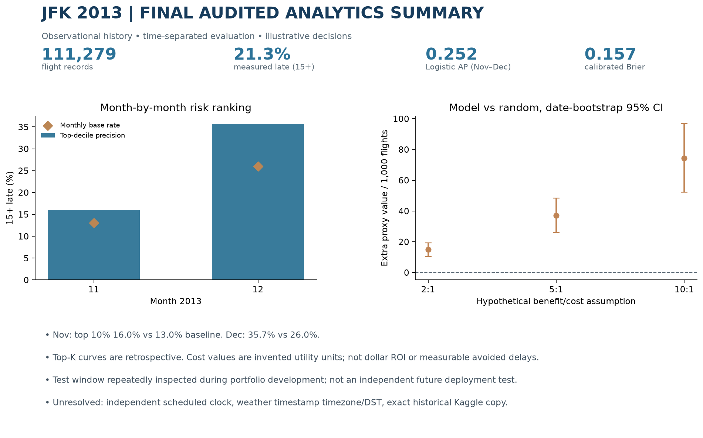
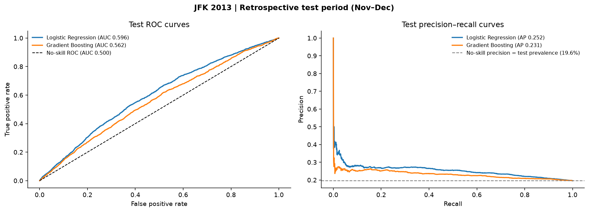
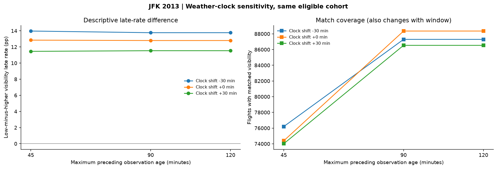

# ✈️ JFK Airport Flight Delay Analysis


This project examines **flight delays at John F. Kennedy International Airport (JFK)** using historical flight and weather data from 2013.

The analysis explores how departure delays vary across airlines, destinations, and time periods, and whether historical flight information can help identify flights with a higher risk of delay.

Along with exploratory data analysis, the project includes statistical modeling, machine learning, weather-related comparisons, and model validation. Particular attention is given to data quality and the limitations of the available records.

---

## 🔍 Project Overview

### Objective

- Analyze historical departure delays at JFK Airport.
- Identify differences in delay patterns across airlines, routes, and time periods.
- Examine relationships between recorded weather conditions and flight delays.
- Evaluate whether pre-departure information can help rank flights by delay risk.
- Assess model performance, uncertainty, and data limitations.

### Key Questions

1. Which airlines, routes, and time periods experienced higher departure delay rates?
2. Were extreme delays concentrated on particular days, and how did departure delays change by arrival?
3. How were recorded weather conditions associated with delays?
4. Can statistical and machine learning models identify flights with higher delay risk?
5. How reliable are these findings across different evaluation periods and data-quality conditions?

### Dataset Overview

| Dataset | Description |
|---|---|
| `jfk_flights.csv` | 111,279 historical JFK departure records from 2013 |
| `jfk_weather2013_2.csv` | 13,424 historical weather observations associated with JFK |
| Analysis period | January–December 2013 |
| Primary target | Departure delay of at least 15 minutes |
| Historical test period | November–December 2013 |

Of the 111,279 flight records, 109,416 contain a measured departure delay. Records without a measured delay are not automatically classified as canceled flights.

The historical data were used for retrospective analysis rather than real-time flight prediction.

---

## 🧠 Methodology

### 1. Data Collection & Preparation

- Loaded historical flight and weather datasets.
- Inspected missing values, data types, and inconsistent records.
- Prepared date and time variables for exploratory analysis.
- Created departure delay categories and indicators.
- Examined missing departure-delay records separately.
- Reviewed weather matching coverage and sample selection.

The flight dataset does not provide an independently recorded scheduled departure timestamp. Reconstructed time information is used only for descriptive analysis, not as an input to prospective delay prediction.

### 2. Exploratory Data Analysis (EDA)

Exploratory analysis examines how delay patterns differ across the historical data.

Key areas include:

- Monthly and daily departure delay trends.
- Airline-level delay comparisons.
- Destination and route-level differences.
- Delay distributions and extreme-delay events.
- Departure and arrival delay comparisons.
- Aircraft delay persistence within observed JFK records.

### 3. Weather and Statistical Analysis

Historical JFK weather observations were examined alongside flight records to study associations between weather conditions and departure delays.

The analysis includes:

- Visibility, wind speed, temperature, and precipitation comparisons.
- Weather observation matching and timestamp sensitivity checks.
- Missing-weather measurements and sample attrition.
- Logistic regression with airline, route, and calendar controls.
- Adjusted odds ratios and confidence intervals.
- Weather interaction analysis.

Weather findings are observational. Incomplete weather measurements, uncertain timestamp conventions, and selection effects limit how broadly the results can be interpreted.

### 4. Machine Learning & Prediction

Two classification models were evaluated for identifying flights with a higher probability of departing at least 15 minutes late:

- **Logistic Regression**
- **Gradient Boosting**

The modeling workflow includes:

- Chronological training, validation, and testing.
- Model comparison using ROC-AUC and Average Precision.
- Precision–Recall curve analysis.
- Probability calibration.
- Feature importance and ablation checks.
- High-risk flight ranking.
- Prediction error analysis.

Additional experiments examine severe delays of 60 and 120 minutes and use quantile regression to estimate different levels of positive departure delay.

### 5. Model Validation & Robustness

Model evaluation extends beyond a single performance score.

The notebook includes:

- Expanding-window validation.
- Bootstrap confidence intervals.
- Probability calibration and Brier Score comparisons.
- Airline-level error and calibration checks.
- Data drift analysis.
- Weather matching sensitivity tests.
- Illustrative cost and decision-threshold scenarios.

The November–December 2013 test period was reviewed during project development. Results from that period should therefore be interpreted as retrospective evaluations rather than a fresh, independent external validation.

---

## 📊 Key Insights

### 1. Departure Delay Patterns

- The overall 15-minute departure delay rate among flights with recorded delay values was approximately **21.3%**.
- Delay patterns varied across airlines, destinations, and time periods.
- Extreme delays were not evenly distributed throughout the year.

These results describe historical patterns rather than current JFK operating conditions.

### 2. Weather Data Quality Matters

Weather analysis required additional filtering and matching.

- 108,605 flights remained eligible after the estimated flight-clock checks.
- 88,340 flights had the visibility and wind measurements needed for the main adjusted weather regression.
- Flights excluded near ambiguous date boundaries had substantially higher observed delay rates.

This means weather-related results describe a selected subset of flights rather than every recorded JFK departure.

### 3. Predictive Models Show Limited but Measurable Signal

The historical test results were:

| Metric | Result |
|---|---:|
| Logistic Regression ROC-AUC | 0.596 |
| Logistic Regression Average Precision | 0.252 |
| Gradient Boosting Average Precision | 0.231 |
| Test-period delay prevalence | 0.196 |
| Brier Score before calibration | 0.182 |
| Brier Score after Platt calibration | 0.157 |

Logistic Regression performed better than Gradient Boosting on Average Precision in the historical test period.

Although the models identified some differences in delay risk, their performance was not strong enough to support a reliable operational alert system.

### 4. Higher Predicted Risk Does Not Guarantee a Delay

The highest-scored 10% of test flights had an observed departure delay rate of approximately **27.0%**, compared with 19.6% across the full test period.

This suggests some ability to rank historical flight risk, but it does not establish that the predictions would remain accurate in future years.

### 5. Model Reliability Requires More Than Accuracy

Probability calibration improved the historical Brier Score, but subgroup analyses still revealed substantial prediction errors for some airlines.

The results highlight the importance of checking calibration, false alarms, data completeness, and changes in model performance over time.

---

## 📈 Data Visualization

### Executive Summary



The executive summary brings together the main delay patterns, model results, and limitations of the historical analysis.

### Flight Delay Prediction — ROC and Precision–Recall



The ROC and Precision–Recall curves compare the classification models against historical reference performance. The Precision–Recall baseline represents the observed delay rate in the test period.

### Weather Matching Sensitivity



This analysis examines how changes in the weather observation matching window affect both the estimated delay-rate differences and the number of flights with usable weather measurements.

Additional visualizations, including airline comparisons, adjusted weather odds ratios, probability calibration, and model diagnostics, are available in the notebook and `images/` directory.

---

## 🛠 Tech Stack

**Language**
- Python

**Environment**
- Jupyter Notebook

**Data Processing**
- pandas
- NumPy

**Statistical Analysis**
- SciPy
- statsmodels

**Machine Learning**
- scikit-learn

**Visualization**
- Matplotlib

**Techniques**
- Exploratory Data Analysis
- Data Cleaning and Aggregation
- Statistical Regression
- Classification
- Quantile Regression
- Chronological Model Validation
- Probability Calibration
- Bootstrap Analysis
- Model Diagnostics

---

## 🗂️ Repository Structure

```text
JFK-Airport-Flight-Delay-Analysis/
│
├── README.md
├── requirements.txt
│
├── notebooks/
│   └── JFK_Flight_Delay_Analysis.ipynb
│
├── data/
│   ├── jfk_flights.csv
│   └── jfk_weather2013.csv
│
├── images/
│   └── ... saved analysis visualizations
│
└─── results/
    └── ... summary tables and model metrics
```

*The structure above shows the intended repository organization. Raw data files should only be published when their redistribution permissions have been confirmed. The legacy script in `src/` is not required to execute the main notebook.*

---

## 🚀 How to Run

### 1. Install the Required Libraries

Install the Python dependencies:

```bash
pip install -r requirements.txt
```

### 2. Prepare the Dataset

Place the required CSV files in the `data/` directory:

```text
data/
├── jfk_flights.csv
└── jfk_weather2013_2.csv
```

The filenames must match the names expected by the notebook.

### 3. Open the Notebook

```bash
jupyter notebook notebooks/JFK_Flight_Delay_Analysis.ipynb
```

Run the cells in order.

The notebook supports the project directory structure shown above and can also locate data in the original Windows workspace:

```text
I:\Dataset\JFK Airport Webscraping
```

Generated figures and analysis tables are saved in the appropriate output directories.

---

## ⚠️ Limitations

Several limitations should be considered when interpreting the analysis.

- **Historical scope:** The findings are based on 2013 flights and should not be assumed to represent current JFK operations.
- **Data provenance:** The exact archived source and redistribution permissions of the saved CSV files have not been independently verified.
- **Flight timestamps:** Independently recorded scheduled departure times are unavailable in the flight file.
- **Weather timestamps:** The timezone and daylight-saving conventions of the weather observations have not been verified.
- **Sample selection:** Weather analysis excludes records with uncertain time alignment or incomplete measurements.
- **Causality:** Associations between weather conditions and delays do not establish causal relationships.
- **Model validation:** The historical test period was examined during development and is not a new external holdout.
- **Operational use:** The models have not been validated for real-time deployment. Cost scenarios are illustrative rather than measured financial savings.

Future analysis would benefit from verified scheduled departure times, confirmed weather timestamps, additional years of flight data, and independent model validation.

---

## 📌 Conclusion

The 2013 JFK data reveal differences in flight delay patterns across airlines, destinations, and time periods.

Statistical analysis provides additional context for weather-related delay patterns, while machine learning models show a modest ability to distinguish between lower-risk and higher-risk departures.

The project also demonstrates why data quality, sample selection, model calibration, and validation methods matter when evaluating predictive results.

Overall, the analysis provides a retrospective examination of JFK flight delays and illustrates both the value and limitations of using historical aviation data for statistical and predictive modeling.
